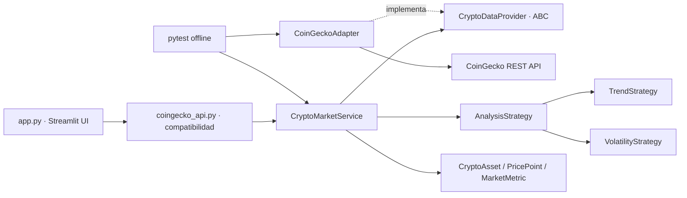

# NovaCrypto · Market Intelligence

Panel de análisis de mercado de criptomonedas construido con Streamlit. El sistema
consulta precios y capitalización de CoinGecko, presenta tendencias e históricos y
ofrece comparación de activos y un asistente Gemini opcional. Se preserva el contrato
de datos que consume la interfaz actual (`id`, `name`, `symbol`, precios, y las columnas
históricas `Fecha`/`Precio`).

## Arquitectura y alcance

`app.py` permanece como punto de entrada requerido por Streamlit Community Cloud. La
integración existente `coingecko_api.py` se mantiene como una fachada de compatibilidad,
y delega la lógica de datos al nuevo paquete `src/`. Los módulos de `src/` no dependen
de Streamlit; las pruebas se ejecutan sin acceso a la red.



### SOLID y patrones aplicados

| Principio/patrón | Archivo y clase | Propósito |
| --- | --- | --- |
| DIP + puerto abstracto | `src/adapters/crypto_data_provider.py`, `CryptoDataProvider` | Define el contrato de acceso a mercado; el servicio depende de la abstracción, no de HTTP ni del proveedor concreto. |
| Adapter | `src/adapters/coingecko_adapter.py`, `CoinGeckoAdapter` | Aísla solicitudes CoinGecko y convierte payloads externos en `CryptoAsset` y `PricePoint`. |
| SRP / orquestación de casos de uso | `src/services/market_service.py`, `CryptoMarketService` | Transforma entidades en los dataframes compatibles y calcula indicadores técnicos, separado de la presentación y la red. |
| Strategy | `src/services/analysis_strategy.py`, `AnalysisStrategy` | Define el contrato de análisis intercambiable. |
| Strategy | `TrendStrategy` | Calcula variación porcentual y dirección de tendencia. |
| Strategy | `VolatilityStrategy` | Calcula desviación estándar de retornos y promedio móvil configurable. |
| Entidades tipadas | `src/models/crypto_asset.py`, `CryptoAsset`; `src/models/price_point.py`, `PricePoint`; `src/models/market_metric.py`, `MarketMetric` | Representan el dominio sin acoplarlo a la forma de la respuesta REST. |
| Compatibilidad | `coingecko_api.py` | Mantiene los nombres y los esquemas de salida ya utilizados por `app.py`, resolviendo secretos en el borde de la aplicación. |

## Requisitos e instalación

Se recomienda Python 3.10 o superior.

```bash
python -m venv .venv
source .venv/bin/activate       # Windows: .venv\Scripts\activate
pip install -r requirements.txt
```

Configura opcionalmente `COINGECKO_API_KEY` y `GEMINI_API_KEY` como variables de
entorno o en Streamlit Secrets. Sin una clave Gemini el dashboard de mercado sigue
funcionando y el asistente informa que falta la configuración.

## Ejecución y calidad

```bash
streamlit run app.py
pytest -qlake8 .
```

Las pruebas de `tests/test_adapters.py`, `tests/test_strategies.py` y
`tests/test_services.py` reemplazan las llamadas HTTP y son deterministas/offline.
Flake8 se configura en `.flake8` con 100 caracteres por línea.

## Despliegue

- **Desarrollo:** rama de trabajo local, entorno virtual y secretos en variables de
  entorno; ejecutar `pytest -q` y `flake8 .` antes de integrar cambios.
- **Producción:** Streamlit Community Cloud conectado al repositorio y a la rama
  protegida elegida para despliegue. Mantener `app.py` en la raíz y configurar allí
  los secretos `COINGECKO_API_KEY` y `GEMINI_API_KEY` cuando correspondan.
- **Responsable:** mantenedor/a del repositorio (propietario/a del despliegue), quien
  revisa cambios, secretos, salud de la app y dependencias.
- **Respaldo:** Git conserva el historial de código; etiquetar cada versión publicada.
  Mantener una copia segura de la configuración de Streamlit Secrets fuera del repo,
  nunca versionar credenciales. Para cambios de datos/configuración, respaldar los
  valores necesarios en el sistema de origen antes de desplegar.
- **Rollback:** en Streamlit Cloud seleccionar el último commit estable (o revertir
  el commit problemático en Git), restaurar la configuración/secrets respaldados y
  reiniciar el despliegue. Verificar carga del mercado, histórico y comparador tras
  la reversa.
